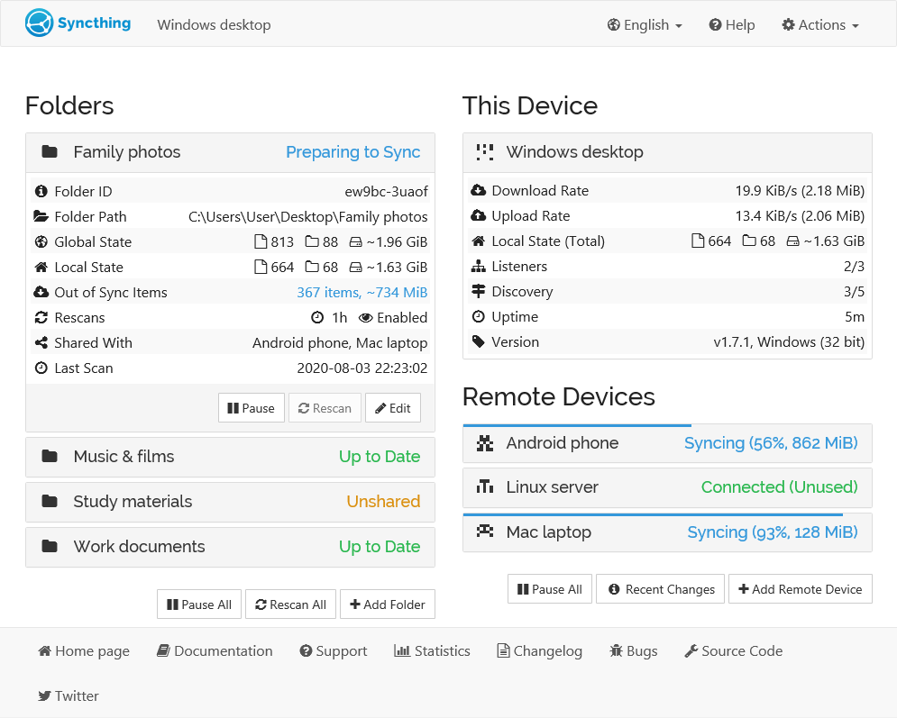

# Syncthing for Files Shared Across Your Devices

A laptop can hold working documents while a home computer keeps another copy ready for the next session. Syncthing exchanges file changes between approved devices, with encrypted connections and no central cloud storage account.

[](https://the-syncthing-foundation.github.io/Syncthing/)

## Decide what each folder may change

Folder types determine which local and remote changes participate in synchronization.
Choose them for each device separately, based on where editing should happen.

| Folder type | Publish local edits | Apply remote edits | Typical role |
| --- | --- | --- | --- |
| Send & Receive | Yes | Yes | Documents edited on several computers |
| Send Only | Yes | No | A reference collection maintained on one device |
| Receive Only | No | Yes | A replica that should follow other devices |

Receive Only still accepts remote deletions and redistributes changes received from the cluster. Send Only can report differences without applying them; overriding those differences enforces its local state elsewhere.
The [folder type documentation](https://docs.syncthing.net/users/foldertypes.html) explains these actions and their consequences.

The folder editor is represented by [editFolderModalView.html](gui/default/syncthing/folder/editFolderModalView.html).
Override and revert actions appear in [revertOverrideView.html](gui/default/syncthing/folder/revertOverrideView.html).
Removing a folder from synchronization has its own dialog in [removeFolderDialogView.html](gui/default/syncthing/folder/removeFolderDialogView.html).

## Leave caches and temporary work behind

Ignore patterns let a shared project contain local working files without sending every cache or scratch artifact.
Place a UTF-8 `.stignore` file at the root of the synchronized folder.

```text
// Keep generated content local
node_modules
*.tmp
/scratch
```

This example excludes directories named `node_modules`, temporary files matching `*.tmp`, and the root-level `scratch` directory.
Patterns are evaluated in order, and the first matching pattern determines the result.
The `.stignore` file itself is not synchronized, so configure each device deliberately.
See the [ignore pattern reference](https://docs.syncthing.net/users/ignoring.html) for exceptions and shared includes.

The developer helper [main.go](cmd/dev/stfindignored/main.go) lists ignored files under a folder root.
It is a separate source tool rather than a required step for ordinary synchronization.

## Understand why a folder is still changing

Filesystem notifications and periodic scans detect edits; Syncthing then compares file information and requests needed blocks.
Both peers must be available for a transfer, though already synchronized files remain usable offline.

- [neededFilesModalView.html](gui/default/syncthing/transfer/neededFilesModalView.html) presents files still needed locally.
- [remoteNeededFilesModalView.html](gui/default/syncthing/transfer/remoteNeededFilesModalView.html) presents files needed by a remote device.
- [failedFilesModalView.html](gui/default/syncthing/transfer/failedFilesModalView.html) presents file transfer errors.

Check the pending file and its error before changing folder modes or ignoring the entire directory.
Naming differences such as `Report.txt` and `report.txt` can prevent synchronization onto a case-insensitive filesystem.

## Keep recovery separate from replication

Deleting a shared file can propagate that deletion to other devices.
A second synchronized copy therefore needs an additional recovery policy if it is expected to protect earlier work.

File versioning is configured per folder and per device, and is disabled by default.
It archives previous files when remote changes replace or delete them; it does not capture a file's earlier contents before a local edit.
Trash Can, Simple, Staggered, and External versioning offer different retention behavior.
The [versioning guide](https://docs.syncthing.net/users/versioning.html) describes their limits.


The restoration interface includes these related views:

- [restoreVersionsModalView.html](gui/default/syncthing/folder/restoreVersionsModalView.html) displays available versions.
- [restoreVersionsVersionSelector.html](gui/default/syncthing/folder/restoreVersionsVersionSelector.html) provides version selection.
- [restoreVersionsConfirmation.html](gui/default/syncthing/folder/restoreVersionsConfirmation.html) confirms restoration.

Concurrent edits can create a file with a `sync-conflict` name for manual comparison.
That conflict copy is an ordinary file and can synchronize to other peers.
The Receive Only local-change list is represented by [localChangedFilesModalView.html](gui/default/syncthing/transfer/localChangedFilesModalView.html).

## Trust devices and share specific folders

Each device has an identity derived from its cryptographic certificate.
Approve the intended peer and share the intended folder; connecting a device does not automatically share every local directory.
Folder IDs identify the shared dataset, while its filesystem location can differ between devices.



The device settings and identity views expose different parts of this relationship:

- [editDeviceModalView.html](gui/default/syncthing/device/editDeviceModalView.html) contains device configuration controls.
- [shareDeviceIdDialogView.html](gui/default/syncthing/device/shareDeviceIdDialogView.html) presents identity-sharing options.
- [idqrModalView.html](gui/default/syncthing/device/idqrModalView.html) presents a device ID as a QR code.
- [editShareTemplate.html](gui/default/syncthing/core/editShareTemplate.html) provides shared interface elements for sharing choices.

Discovery helps peers find addresses, and relays can carry encrypted traffic when a direct connection is unavailable.
Those services serve different purposes from centralized storage.
The connection status view is [connectivityStatusModalView.html](gui/default/syncthing/core/connectivityStatusModalView.html).

## Run the engine without opening a browser

The core process provides synchronization and a browser-based management interface.
For an existing configuration, this PowerShell example starts it without opening a browser window:

```powershell
$syncState = ".\syncthing-state"
# Point this at the existing instance's state directory.
syncthing serve --home=$syncState --no-browser
```

Use the correct state directory: a new directory creates a separate configuration and device identity.
The [command-line reference](https://docs.syncthing.net/users/syncthing.html) documents these options.

For Syncthing Docker deployments, preserve the container's state and synchronized data across recreation.
This Compose fragment uses the official image and a named persistent volume:

```yaml
services:
  syncthing:
    image: syncthing/syncthing:latest
    volumes:
      - sync-state:/var/syncthing
    restart: unless-stopped
volumes:
  sync-state:
```

The fragment intentionally leaves networking unspecified; choose it for the host and peer connection requirements.
Container network isolation can affect local discovery, and the GUI requires authentication when made externally accessible.
The supplied [Dockerfile](Dockerfile) defines the image, and [docker-entrypoint.sh](script/docker-entrypoint.sh) handles its startup environment.

Application settings are represented by [settingsModalView.html](gui/default/syncthing/settings/settingsModalView.html).
[advancedSettingsModalView.html](gui/default/syncthing/settings/advancedSettingsModalView.html) exposes advanced configuration, while [logViewerModalView.html](gui/default/syncthing/core/logViewerModalView.html) displays logs.

## Account for mobile integration differences

Syncthing Android users should distinguish the archived official Android wrapper from community alternatives such as Syncthing-Fork.
Syncthing iOS use depends on separate integrations such as Synctrain, with their own app behavior and platform restrictions.
The [community integrations directory](https://docs.syncthing.net/users/contrib.html) identifies these projects and their maintainers.
Check the chosen integration's background execution and file access behavior before relying on unattended mobile transfers.

## Project scope and supplied sources

[The Syncthing Foundation's project site](https://syncthing.net/) provides official release and community links.
The supplied [GOALS.md](GOALS.md) explains the project's priorities, and [LICENSE](LICENSE) contains Mozilla Public License 2.0.
This uploaded source selection includes interface, infrastructure, and database files, but omits parts of the core engine and root README.
The linked files document the supplied selection; they do not constitute a complete buildable checkout.

## Related Search Terms

The Syncthing Foundation, Syncthing, Syncthing android, syncthing ios, syncthing docker, synchronization, file-sync, p2p, peer-to-peer, encryption, go, self-hosted, cross-platform, file-sharing, docker
